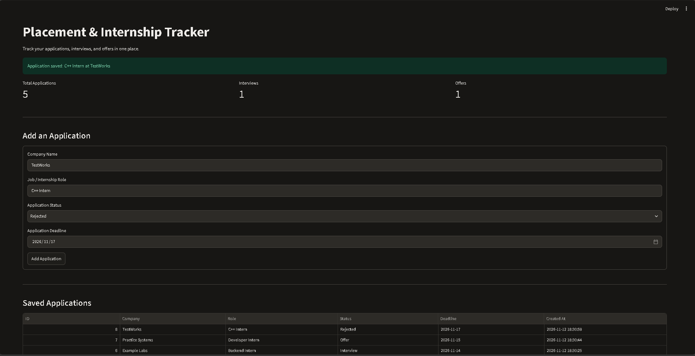
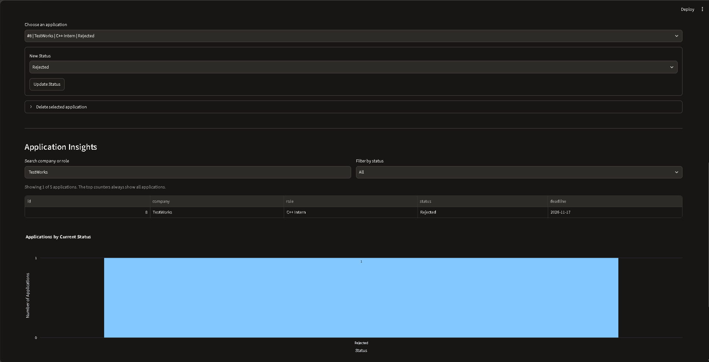
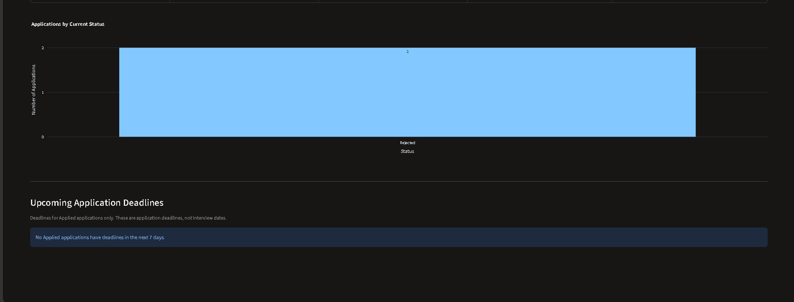

# Placement & Internship Tracker

A local application for tracking job and internship applications, built with Python, Streamlit and SQLite.

## Preview

Screenshots use fictional demo applications.

### Dashboard


### Search, Filters and Status Chart


### Upcoming Deadlines


## Features

- Add applications with a company, role, status and deadline.
- Update an application's status.
- Delete an application after confirmation.
- Search by company or role and filter by status.
- View application totals and a status distribution chart.
- View deadlines for Applied applications due today or within seven days.
- Keep application data between local app restarts using SQLite.

## Tech Stack

- Python
- Streamlit
- SQLite
- Pandas
- Plotly

## Run Locally on Windows

Install Python and Git, then download or clone this repository.
Open a terminal inside the project folder and run:

```powershell
py -m venv .venv
.\.venv\Scripts\python.exe -m pip install -r requirements.txt
.\.venv\Scripts\python.exe -m streamlit run app.py
```

Open the Local URL printed in the terminal.

The application creates `applications.db` automatically on its first run.
No separate database server is required.

## Project Structure

```text
placement-tracker/
├── app.py              # Streamlit interface, filters and charts
├── database.py         # SQLite queries and database setup
├── requirements.txt    # Python dependencies
├── .gitignore          # Excludes local data, environment and secrets
└── README.md
```

## Live Demo

[Try the Placement Tracker](https://nakul-placement-tracker.streamlit.app/)

The public demo uses fictional, session-only data.
The local version uses SQLite to save applications between restarts.

## Data and Privacy

Application data stays in the local SQLite database.
The database and virtual environment are excluded from Git.
Use fictional data when taking screenshots or sharing a demo.

## Current Limitations

- Designed for local, single-user use; there is no authentication.
- Deadline notices appear inside the app, not through email or push notifications.
- The deadline section currently includes only applications marked Applied.
- The app tracks records entered by the user; it does not submit job applications.
- CSV export and persistent multi-user cloud storage are not implemented.

## Planned Improvements

- Add a Wishlist / Not Applied status.
- Export application data to CSV.
- Add automated database tests.
- Prepare a demo deployment with an appropriate data-storage strategy.